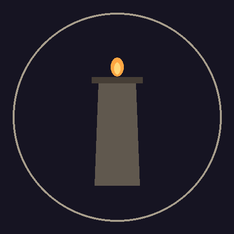

# dat-record-suppression

Title block: the name above is set in Bpmf Huninn in beacon amber on a dusk ridge plate, with a stone rule beneath it and one small tower at the left of the first heading only, in the manner of a chronicle heading.

# dat-Record-Suppression
Removes entire records from a dataset if they contain sensitive information identified by a pattern (e.g., SSN regex). Takes pattern and column name as arguments. Uses regex module. - Focused on A collection of utilities for anonymizing sensitive data in datasets. Includes tools for replacing real names, addresses, phone numbers, and other PII with fake but realistic values, while preserving data structure and relationships. Supports various data formats like CSV and JSON.

## Install
`git clone https://github.com/ShadowGuard-AI/dat-record-suppression`

## Usage
`python3 main.py --file INPUT.csv --column COLUMN --pattern PATTERN --output OUTPUT.csv`

## Parameters
- `-h`: Show help message and exit
- `--file`: Path to the input CSV file (required).
- `--column`: Name of the column to check for sensitive information (required).
- `--pattern`: Regex pattern to identify sensitive information (required).
- `--output`: Path to the output CSV file (required).

## License
Licensed under the terms in LICENSE.

## Chronicle notes, gathered along the ridge

The buttons of this re-skin read Drop Matching Rows, Show the Count, and Read the Chronicle. Its headings read Whole Rows Leave, One Column Is Tested, Search Is Not Full Match, The Empty Cell Trap, and Every Control Is Required. The live README carries no install identity fault: its install line names ShadowGuard-AI correctly, with hyphen and no .git ending, and its licence line reads Licensed under the terms in LICENSE. The repository LICENSE file carries an MIT style licence text. Its holder line gives a pen name together with a single initial for the remaining name. That fact is recorded. The initial is not expanded.
